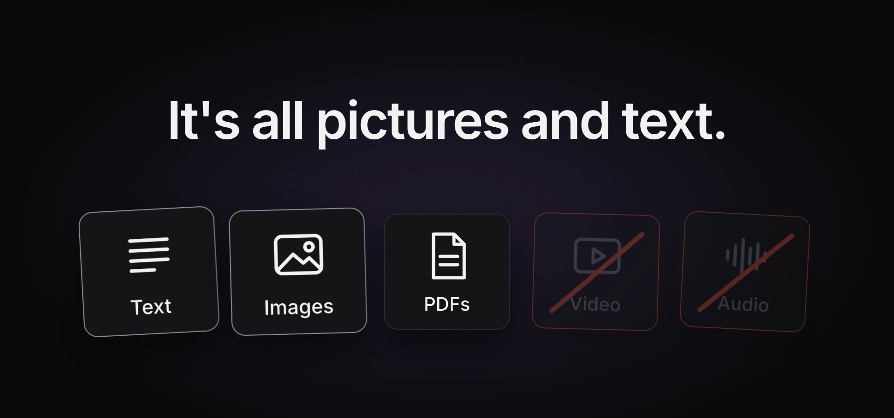
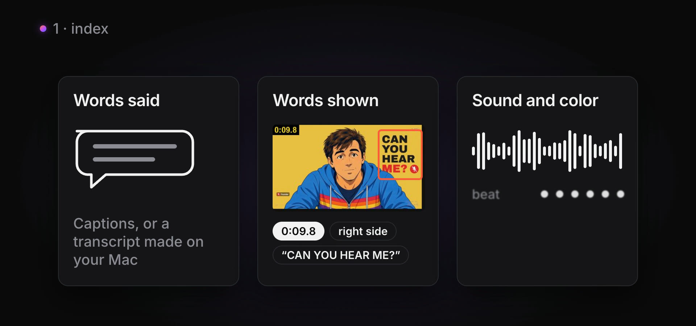
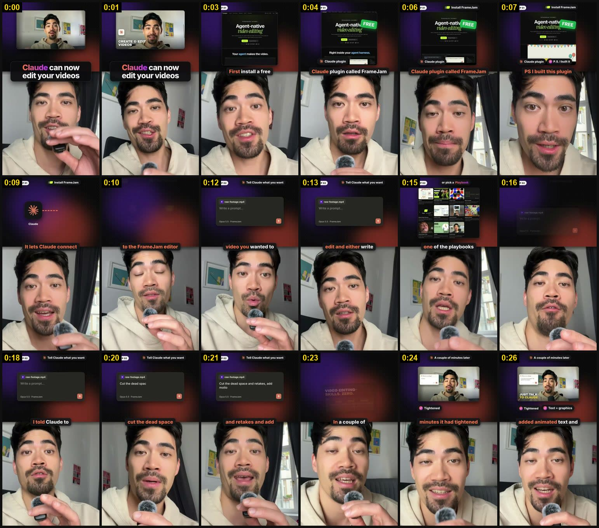
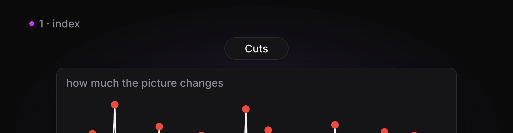
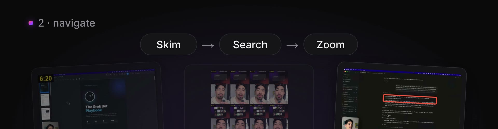
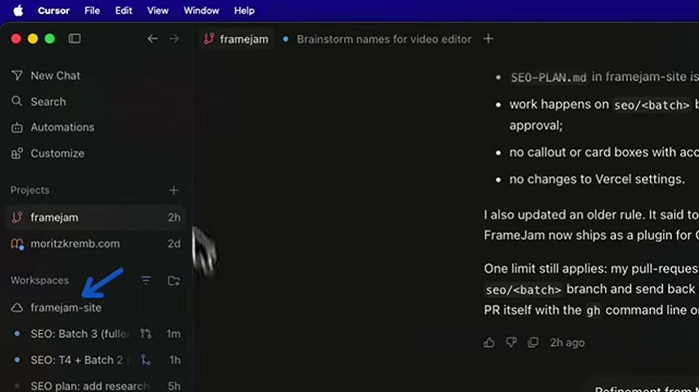
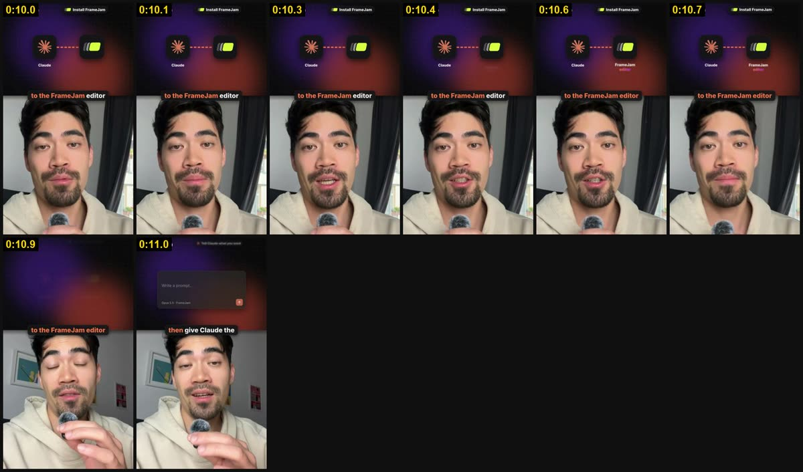
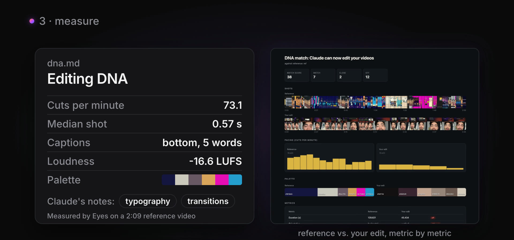

# Claude Eyes

**Give your coding agent eyes for video.**

Claude, Codex and other coding agents can read text and look at images, but they can't watch a video. Eyes turns any
video into evidence an agent can read, then lets it move around inside the video the way you would: skim, search, zoom
in, and measure. Everything runs on your Mac. Nothing is uploaded.



```text
You:    Watch this 20-minute tutorial and give me every setup step with the exact commands.
Claude: eyes index "https://youtube.com/watch?v=..."
        eyes search "install"
        eyes crop tutorial 12:02 --box 0.3,0.3,0.45,0.4
        → Every step with its timestamp and the exact command read off the screen.
```

## What you can do with it

| Ask your agent to... | What Eyes gives it |
|---|---|
| **Summarize or answer questions** about any video | Contact sheets, transcript and on-screen text, all with timestamps |
| **Pull exact steps from a tutorial** | Sharp crops of the screen to read commands that were never said out loud |
| **Search your whole library** | Every moment a word was said or shown, across all indexed videos |
| **Copy an editing style** | Measured "editing DNA" of a reference: cuts per minute, shot lengths, captions, loudness, palette |
| **Check your edit before publishing** | Your edit vs the reference, metric by metric: match, close or off |
| **Study competitors** | Hooks, pacing and caption style of their videos, side by side |
| **Find clips in a longform** | Moments worth cutting into shorts, with exact in and out points |

## Install

Works on macOS, Linux and Windows. You need Python 3.10+ and ffmpeg (`brew install ffmpeg`,
`sudo apt install ffmpeg` or `winget install ffmpeg`).

```bash
uv tool install git+https://github.com/moritzkremb/claude-eyes   # or: pipx install git+https://github.com/moritzkremb/claude-eyes
eyes setup                                                       # checks everything and says what's missing
```

Then give your agent the skill, which teaches it how to use Eyes well:

```bash
mkdir -p ~/.claude/skills && cp -r skills/eyes ~/.claude/skills/   # Claude Code
```

Optional extras (`eyes setup` prints the right install command for your system):
- **yt-dlp** to index YouTube and other URLs
- **whisper.cpp** plus `eyes setup --download-model small.en` for local transcripts
- **An ElevenLabs API key** (`ELEVENLABS_API_KEY`) if you want the opt-in cloud transcriber
- On-screen text works out of the box: Apple Vision on macOS, RapidOCR on Linux and Windows. On a Mac you can
  add RapidOCR too with `uv tool install "claude-eyes[ocr] @ git+https://github.com/moritzkremb/claude-eyes"`.

Now just ask: *"Use eyes to watch this video and tell me..."*

## How it works

Eyes works in three steps: **index** the video once, **navigate** it to answer the question, and **measure** it when
style matters.

### 1. Index once

`eyes index` takes a URL or a local file and builds a cache in `~/.cache/eyes/<id>/`. Running it again is instant.
A 1-minute short takes about half a minute; a 20-minute video takes a few minutes.



It records five tracks:

- **Pictures:** frames sampled at 0.5 to 4 per second, laid out as labelled contact sheets.
- **Cuts:** every place the picture jumps to a new shot.
- **Words said:** captions the creator uploaded, else a transcript made locally with whisper.cpp, else the
  platform's automatic captions.
- **Words shown:** on-screen text with its timing and position on screen.
- **Sound and color:** a loudness curve, silences, beat estimate and the color palette.

The agent reads one contact sheet instead of hundreds of separate screenshots. Each tile carries its timestamp, so
every claim can point to a moment:



**Finding cuts properly.** The usual way is ffmpeg's scene filter with a fixed threshold. On a talking-head short
with 15 real cuts, the standard setting found 1. Most jump cuts barely change the picture: same face, same
background. Eyes looks for sudden spikes compared with the frames right around each moment, so small but instant
changes still count. On the same short it found 13 of 15.



**Better transcripts when you need them.** By default everything stays local. Add `--transcriber elevenlabs` to
send the audio to [ElevenLabs Scribe](https://elevenlabs.io/speech-to-text) instead. You get speaker labels and
sound events, so the agent can tell who said what and "hear" music, laughter or applause:

```text
$ eyes index reference.mp4 --transcriber elevenlabs
## Sounds (heard, not said)
- [0:00] upbeat music
- [2:02] upbeat music

## Transcript (what was said)
[0:09] S1: Can you hear me?
[0:11] S2: You're on mute.
```

`--glossary "FrameJam, Claude Code"` helps both whisper and ElevenLabs spell names right.

### 2. Navigate: skim, search, zoom

The agent starts wide and only zooms in where the question needs it, so it opens a handful of images instead of
hundreds.



**Search** what was said or shown, in one video or across everything you've indexed:

```text
$ eyes search playbook
# 25 match(es) for 'playbook'
- draft-06 @ 0:11 [said] the video you wanted to edit and either write a prompt or pick one of the playbooks.
- draft-06 @ 0:15 [shown] or pick a Playbook
- draft-06 @ 0:49 [shown] 02 Prompt or Playbook
```

**Crop** any region at full resolution to read small text or code:

```bash
eyes crop grok 12:02.4 --box 0,0,0.5,0.5    # top-left quarter of the frame at 12:02.4
```



**Burst** catches fast moments a normal sample would skip: 8 frames across one second.

```bash
eyes burst draft-06 0:10.5
```



Also: `eyes frames ID --at 1:23,4:05` for exact moments and `eyes frames ID --range 1:00-1:20` for a section.

### 3. Measure: editing DNA

`eyes dna` turns a reference video into a spec you can edit against. The agent then views the shot sheets and adds
what numbers can't capture (typography, transitions, layout) with `eyes note`.



```text
$ eyes dna moat
- Cuts per minute: 73.1        - Words per caption: 5
- Median shot: 0.57 s          - Captions in ALL CAPS: 93%
- Shots under 1 s: 77%         - Words per minute: 146
- Cuts in the first 3 s: 3     - Loudness: -16.6 LUFS
```

Then check your edit against it:

```bash
eyes index my-render.mp4
eyes compare moat my-render     # every metric marked match, close or off
eyes report moat --vs my-render --open    # single-file HTML report, side by side
```

Fix what's off, re-render, compare again.

## Commands

```text
eyes index SRC          build the index for a URL or file
eyes overview REF       reprint the index summary
eyes search QUERY       words said or shown, across one video (--in REF) or the whole library
eyes frames REF         frames at timestamps (--at) or across a range (--range, --fps)
eyes burst REF T        dense frames around one moment
eyes crop REF T --box   high-resolution crop of one region (fractions x,y,w,h)
eyes dna REF            measured editing style (pacing, captions, audio, color)
eyes note REF KEY TEXT  add a style note from viewing the sheets
eyes compare REF CAND   how closely an edit matches a reference
eyes report REF         single-file HTML report (--vs CAND for side by side)
eyes library            list indexed videos
eyes setup              check dependencies (--download-model NAME fetches a whisper.cpp model)
```

`REF` can be any unique part of a video's id or title, its URL, or its file path.

## Good to know

- **Private by default.** Video and audio never leave your machine, unless you choose `--transcriber elevenlabs`,
  which uploads the audio track only. URLs are downloaded with yt-dlp without your browser cookies.
- **Limited hearing.** Speech arrives as a transcript; music as loudness and beat estimates, plus sound events with
  ElevenLabs. The agent still can't judge tone of voice or sound design.
- **Samples, not every frame.** Contact sheets are samples. The agent should zoom in before claiming small details,
  and the skill tells it to.
- **Cut detection limits.** Slow dissolves can be missed, and big graphic changes in split-screen edits count as cuts.
- **Storage.** The cache lives in `~/.cache/eyes/` (override with `EYES_HOME`). Delete a video's folder to remove it.
  Your source files are never copied or modified.

## License

MIT
